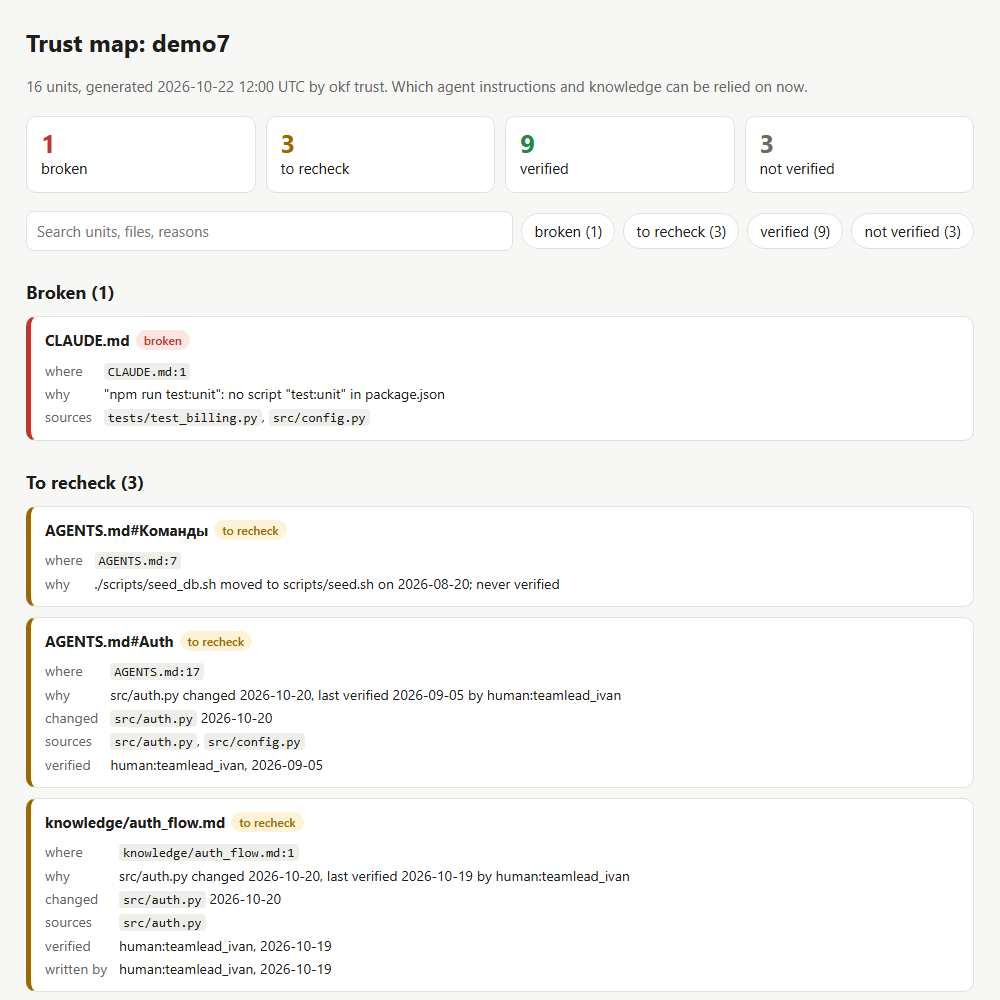
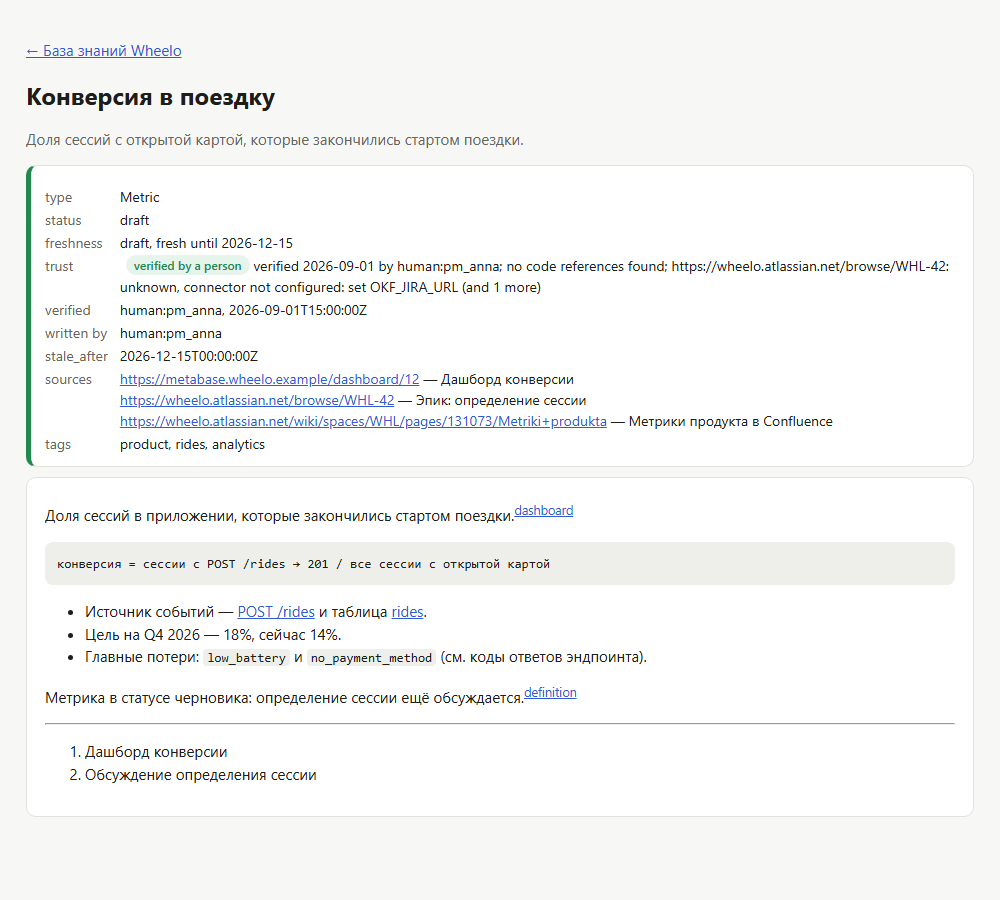

# okf-ai

**okf-ai показывает, каким инструкциям и знаниям для ИИ-агентов можно верить прямо сейчас — что проверено, а что устарело вслед за кодом.**

Агенты пишут код по `AGENTS.md`, `CLAUDE.md`, правилам Cursor и базе знаний. Эти тексты стареют молча:
код меняется, а раздел, который его описывает, никто не перечитал. Одна команда на вашем репозитории,
без разметки и настройки, показывает карту доверия: что подтверждено после последнего изменения кода,
что перепроверить и где ссылки ведут в никуда.

- `okf init` — каркас: бандл знаний, `.okf/trust.yml`, workflow и подсказка в `AGENTS.md`;
- `okf trust` — карта доверия по разделам инструкций и файлам базы знаний; `okf verify` — подтвердить раздел в одно действие;
  `okf trust --html report.html` — та же карта страницей для людей, `okf view` — сайт базы знаний с графом связей;
- `okf fix` — правки: механические без ИИ (переехавший файл, переименованный скрипт) и черновики от LLM для разделов,
  чей код поменялся (`--draft`, свой ключ); правленое остаётся «не подтверждено», пока человек не сделает `okf verify`;
- коннекторы Confluence и Jira: закрытый эпик или новая версия страницы просит перепроверить документ;
  `okf import confluence` переносит страницы в git как документы OKF; свой коннектор — один файл;
- `okf agents-check` и `okf stale` — страж в PR: битые пути и команды в инструкциях, документы, чей код поменялся;
- `okf validate` — валидатор базы знаний [OKF v0.2](https://github.com/GoogleCloudPlatform/open-knowledge-format/blob/main/SPEC.md)
  плюс строгий профиль okf-ai ([спека](etc/spec/cli-validator-v2.md)); `okf agents` — роутер `AGENTS.md` для бандла;
- [GitHub Action](.github/workflows/okf.yml) — всё это на каждом pull request.

Концепция — в [брифе](etc/docs/BRIEF.md).

## Установка

Одна команда, без установки и без PyPI — карта доверия текущего репозитория:

```bash
uvx --from git+https://github.com/Smoooky/okf-ai okf trust .
```

Поставить насовсем — `pipx install git+https://github.com/Smoooky/okf-ai` (или `pip install git+https://…`);
с черновиками от Claude — `pipx install "okf-ai[llm] @ git+https://github.com/Smoooky/okf-ai"`.
Нужны Python 3.10+ и Git (проверено на 3.11 и 3.12). Ставится то, что лежит в ветке по умолчанию на GitHub;
до слияния `feat/okf-cli` добавьте `@feat/okf-cli` к адресу. Проверено локально, без GitHub: `pip install`
из git-адреса локального клона (`git+file://…`), `uvx --from <папка клона> okf trust`, сборка `python -m build`
и `twine check`; `uvx` с `git+https://github.com/…` заработает, когда ветка будет на GitHub.

**PyPI.** Пакет готов к публикации под именем `okf-ai` (на 22.10.2026 имя свободно): `python -m build`,
`twine upload dist/*` — нужен аккаунт PyPI и выбранная лицензия (её пока нет). После публикации —
`uvx --from okf-ai okf trust .` и `pipx install okf-ai`.

Для разработки:

```bash
git clone https://github.com/Smoooky/okf-ai.git
cd okf-ai
pip install -e ".[test]"
python -m pytest
```

(`.[test]` включает `anthropic` для `okf fix --draft`; в работе достаточно `pip install "okf-ai[llm]"`.)

На Windows вместо `pip` и `python` — `py -3.12 -m pip` и `py -3.12`. Если папка `Scripts` не в `PATH`,
команда `okf` не найдётся; тогда запускайте `py -3.12 -m okf ...` — это то же самое.

Команды печатают по строке на находку, сводка уходит в stderr:

```text
[LEVEL] file_path: field_name: message
```

`--format github` печатает то же как команды GitHub Actions — они становятся аннотациями в PR.

## `okf init [repo] [--from-agents] [--force]`

Каркас из брифа одной командой:

```text
okf init: created knowledge/architecture.md
okf init: created knowledge/local_setup.md
okf init: created knowledge/runbook.md
okf init: created knowledge/index.md
okf init: created knowledge/log.md
okf init: created .okf/trust.yml
okf init: created .github/workflows/okf.yml
okf init: created knowledge/AGENTS.md
okf init: updated AGENTS.md
```

- `knowledge/` — бандл OKF: `index.md`, `log.md`, три шаблона (Architecture, Guide, Runbook) с правильной шапкой,
  `status: draft` и `generated: {by: process:okf-init}`, и роутер `knowledge/AGENTS.md`;
- `.okf/trust.yml` — куда `okf verify` пишет подтверждения;
- `.github/workflows/okf.yml` — проверка на каждый PR (как в этом репозитории, okf ставится из git);
- в существующий `AGENTS.md` дописывается раздел «Knowledge base» со ссылкой на роутер (один раз).

Существующие файлы не перезаписываются без `--force`: okf печатает `kept … (it exists; --force overwrites it)`.
`--from-agents` дополнительно предлагает документ знаний на каждый раздел корневых `AGENTS.md` и `CLAUDE.md`:
текст раздела, `sources` — пути из его текста, ссылки переписаны относительно `knowledge/`, тип угадывается по
заголовку (Architecture, Runbook, API Endpoint, Policy, иначе Guide). Всё созданное — черновики: в карте доверия
они «не подтверждены», пока человек не прочитает и не сделает `okf verify knowledge/<файл>`.

## `okf trust [repo] [--since REF] [--strict] [--json]`

```text
okf trust: 16 units: 9 verified and current, 3 to recheck, 1 broken, 3 not verified
[ERROR] CLAUDE.md: trust: "npm run test:unit": no script "test:unit" in package.json
[WARNING] AGENTS.md#Команды: trust: ./scripts/seed_db.sh moved to scripts/seed.sh on 2026-08-20; never verified
[WARNING] AGENTS.md#Auth: trust: src/auth.py changed 2026-10-20, last verified 2026-09-05 by human:teamlead_ivan
[WARNING] knowledge/auth_flow.md: trust: src/auth.py changed 2026-10-20, last verified 2026-10-19 by human:teamlead_ivan
[OK] AGENTS.md#Billing: trust: verified 2026-09-05 by human:maria_backend; sources unchanged since
[INFO] AGENTS.md#Правила: trust: not verified; last edited 2026-09-01; no code references found
```

**Единицы.** Каждый раздел (`##`) инструкций для агентов: `AGENTS.md` и `CLAUDE.md` на любом уровне,
`.cursor/rules/*.mdc`, `.cursorrules`, `.github/copilot-instructions.md`, `.ruler/**/*.md`, `.rulesync/**/*.md`; текст до первого раздела —
отдельная единица `AGENTS.md`, файл без разделов — одна единица. Плюс каждый файл знаний OKF — любой `.md`
с `type` в шапке (или только бандлы из `--bundle DIR`). Роутер, который пишет `okf agents`, не считается.

**Для каждой единицы:**
- *источники* — для инструкций выводятся из текста, как в `agents-check`: пути, ссылки, `package.json` для
  `npm run`, `Makefile` для `make`, файлы скриптов и тестов (маски вида `src/**/*.py` — нет, это область
  действия, а не код); для OKF — `sources[].resource`;
- *последнее подтверждение* — `.okf/trust.yml` для инструкций, `verified` в шапке для OKF;
  если подтверждений нет — когда раздел последний раз правили (`git blame` по его строкам);
- *дата кода* — последний коммит по каждому источнику (`git log -1 --format=%cI -- путь`),
  незакоммиченные правки — по времени изменения файла.

**Уровни:**

| Уровень | Строка | Когда |
|---|---|---|
| сломано | `ERROR` | раздел ссылается на несуществующий файл, скрипт `package.json`, цель `Makefile` |
| перепроверить | `WARNING` | код (страница Confluence, закрытая задача Jira) менялся после подтверждения (или, если подтверждений нет, после правки раздела); упомянутый файл переехал (`git log`: «moved to новый/путь»); раздел правили после подтверждения; у OKF — наступил `stale_after` или `generated.at` позже `verified`, а автор `generated.by` — человек или не указан (`content regenerated … after it was verified`); текст, написанный машиной, — если его источник поменялся после `generated.at` |
| подтверждено | `OK` | последнее подтверждение позже изменений кода: человеком (`human:`) или процессом (`process:`) |
| не подтверждено | `INFO` | подтверждений нет, но и код с тех пор не менялся; или текст после последнего подтверждения написала машина — `generated.by` не `human:` (`okf fix`, черновик LLM, `okf import`, агент): `edited by … ; not verified` |

`--since origin/main` — только то, что этот набор изменений задевает: каждая единица, чей источник изменён,
с указанием файла, и единицы, которые «сломаны» и задеты этим изменением (их источник или сам раздел/документ).
Если тот же PR поправил и сам раздел, он не помечается «перепроверить» (`[INFO] ... changed together in this change`),
но сломанный — остаётся `ERROR`. `--json` — то же для машин; при неполной истории в нём есть `"warnings"`
с подсказкой про `fetch-depth: 0`. Код выхода `0`; с `--strict` — `1`, если есть «сломано» или «перепроверить»,
а с `--since` — если этот набор изменений что-то делает «перепроверить» или задевает сломанное
(сломанное до PR и им не тронутое на код выхода не влияет).

**Чтобы не было ложных «сломано»** (они быстрее всего убивают доверие к отчёту):
- заглушки и примеры (`path/to/file.ts`, `src/foo.py`, `your-project/…`, `example/…`) — статус «неясно», не проверяются;
- пути из `.gitignore` (в корне и во вложенных папках) и обычные результаты сборки (`dist/`, `node_modules/`, `.env`) —
  «неизвестно»: они появляются только после сборки;
- во вложенных инструкциях (`packages/api/AGENTS.md`) пути ищутся от папки файла, потом от корня (в `--json` такая
  связь помечена `ok:root`);
- `CLAUDE.md` — симлинк или однострочная ссылка на `AGENTS.md` — считается один раз; `@AGENTS.md`-импорт
  не делает CLAUDE.md зависимым от правок AGENTS.md;
- копии, которые генерируют [Ruler](https://github.com/intellectronica/ruler) и [rulesync](https://github.com/dyoshikawa/rulesync)
  (маркер в файле или блок Ruler в `.gitignore`), не помечаются: проверяется источник в `.ruler/` или `.rulesync/`,
  а копия получает строку `[INFO] ... Generated from .ruler/`;
- в неполной истории (`actions/checkout` по умолчанию берёт один коммит) дат нет: okf не выдумывает их и пишет
  предупреждение с примером `fetch-depth: 0`.

## Просмотр: `okf trust --html report.html` и `okf view`

`okf trust --html report.html` пишет карту доверия одной страницей: CSS и JS внутри, ни одного внешнего запроса —
открывается офлайн, из артефакта CI или с ноутбука. Сверху сводка, ниже разделы по цветам (сломано — красный,
перепроверить — жёлтый, подтверждено — зелёный, не подтверждено — серый): у каждого файл и строка, причина, какой
источник и когда менялся, кто и когда подтвердил. Фильтр по уровню и поиск; светлая и тёмная тема по настройке
системы; на телефоне карточки в одну колонку. Строка ведёт на GitHub, если репозиторий там (`origin` или переменные
GitHub Actions). Action кладёт `report.html` артефактом `okf-trust-report`.



`okf view <repo> --out site/` — статический сайт базы знаний OKF (каждый бандл с корневым `index.md`):
- главная — текст `index.md` со ссылками на страницы, таблица документов (тип, свежесть, уровень доверия),
  документы по тегам и граф ссылок между документами (SVG без библиотек, цвет — уровень доверия);
- страница документа — Markdown в HTML и шапка: `type`, `status`, свежесть, `verified`, `stale_after`, источники,
  уровень доверия с причиной.



## `okf verify FILE[#SECTION]... [--by ACTOR] [--all-current]`

```bash
okf verify AGENTS.md#Auth                 # один раздел
okf verify AGENTS.md                      # все разделы файла; AGENTS.md# — только текст до первого раздела
okf verify knowledge/auth_flow.md         # файл знаний OKF
okf verify --all-current                  # все неподтверждённые разделы, чей код не менялся
```

`--all-current` не подтверждает то, что после последнего подтверждения человеком написала машина
(`okf fix`, черновик LLM): такие разделы он перечисляет как пропущенные — их читают и подтверждают по одному,
`okf verify AGENTS.md#Auth`.

- Для инструкций пишет в боковой файл `.okf/trust.yml` (ближайший вверх по папкам, иначе в корне git):
  `{unit: AGENTS.md#Auth, hash, sources, verified: [{by, at}]}`. Сами инструкции не трогает; хэш замечает,
  если раздел потом поправили.
- Для OKF дописывает запись в `verified` в шапке, остальной файл не меняется.
- `--by` по умолчанию — `human:` + `git config user.email` (или `user.name`). Раздел ищется по точному заголовку,
  без учёта регистра или по slug (`#getting-started`).

## `okf fix [repo] [--draft] [--apply | --pr]`

Правит то, что нашли `okf trust` и `okf agents-check`. По умолчанию печатает unified diff (`okf fix > fix.patch`,
`git apply fix.patch`), с `--apply` пишет в рабочую копию. Сами инструкции правятся только точечной заменой
в строке, без переформатирования.

**Слой 1 — без ИИ, всегда:**
- упомянутый файл переехал (`git log`, или переименование в PR с `--since`) → новый путь в том же виде
  (`./scripts/seed_db.sh` → `./scripts/seed.sh`, выравнивание комментария сохраняется);
- скрипт в `package.json` переименован (та же команда теперь под одним другим именем) → новое имя;
- источник OKF (`sources[].resource`) переехал → новый путь во frontmatter;
- путь удалён без замены или скрипта не было → правка не выдумывается: «needs a manual fix».

**Слой 2 — `--draft`, черновик от LLM** для разделов, чей код менялся после подтверждения:
- модели передаются текст раздела, его источники и `git diff` источников с момента последнего подтверждения;
  в ответ — новый текст раздела и одна строка «что поменялось и почему» (структурированный JSON);
- модель правит только этот раздел; заголовок менять нельзя; каждый путь и команда в черновике проверяются тем же
  извлечением, что в `agents-check`, — несуществующее отклоняет черновик с причиной;
- дифф больше `--max-diff` (40 000 символов) не обрезается молча, а не отправляется; лимит ответа — `OKF_LLM_MAX_TOKENS` (8000);
- ключ — свой: `ANTHROPIC_API_KEY` (Claude через официальный SDK, `pip install "okf-ai[llm]"`, модель по умолчанию
  `claude-opus-5-5`, меняется через `OKF_LLM_MODEL`; включён серверный `fallbacks: "default"` на случай отказа модели)
  или OpenAI-совместимый эндпоинт: `OKF_LLM_BASE_URL` + `OKF_LLM_API_KEY` + `OKF_LLM_MODEL` (там `temperature: 0`;
  модели Claude параметр `temperature` больше не принимают, детерминизм держится на проверке черновика);
- без ключа `okf fix --draft` говорит, что задать, и показывает только слой 1;
- `--replay FILE` подставляет сохранённый ответ вместо вызова модели (демо, тесты); `--only AGENTS.md#Auth` — один раздел.

**Доверие после правки.** Каждый правленый раздел получает `generated: {by: process:okf-fix | anthropic/<модель>, at}` —
в `.okf/trust.yml` для инструкций, во frontmatter для OKF — и никогда `verified`. В карте доверия он «не подтверждён»
(`edited by … ; not verified`), пока человек не сделает `okf verify`: ИИ правит и понижает доверие, человек подтверждает.

### `okf fix --pr`: правки отдельным pull request (Freshness Engine)

`okf fix --pr [--draft]` делает из правок PR, не трогая текущую ветку:
1. ветка `okf/update-<base>-<short sha>` от текущего коммита;
2. коммит с механическими правками и, если есть `--draft` и ключ, принятыми черновиками ИИ (в `.okf/trust.yml` —
   `generated`, не `verified`);
3. `git push` и `gh pr create` с заголовком `[OKF-Update] 2 sections: AGENTS.md#Команды, AGENTS.md#Auth` и описанием:
   что поменялось и почему (механически или черновик какой модели), что требует человека, и
   «Generated, not verified … `okf verify "AGENTS.md#Команды" "AGENTS.md#Auth"`»;
4. возврат на исходную ветку.

Если `[OKF-Update]` PR в ту же базу уже открыт, второй не создаётся: его ветка получает новый коммит
(`--force-with-lease`), а заголовок и описание обновляются (`gh pr edit`). Нечего править — PR нет. С
незакоммиченными изменениями в рабочей копии `--pr` отказывается. Нужны `git` с remote `origin` и
[GitHub CLI](https://cli.github.com) (`gh auth login` или `GH_TOKEN`). Проверено на временном git-репозитории
с локальным «remote» и подменённым `gh`; настоящий PR на GitHub не открывался.

**В Action — по желанию, по умолчанию выключено.** Задание `auto-pr` запускается на push в `main`, если в
репозитории переменная `OKF_AUTO_PR=true`, или вручную (Run workflow → `okf-auto-pr`). У него `permissions:
contents: write, pull-requests: write`; в настройках репозитория нужно разрешить GitHub Actions создавать PR
(Settings → Actions → General → «Allow GitHub Actions to create and approve pull requests»).

## Источники вне git: Confluence и Jira

В `sources[].resource` документа OKF может стоять не только файл, но и страница Confluence или задача Jira.
`okf trust`, `okf stale` и `okf fix --draft` спрашивают о них коннекторы:

| Коннектор | Ресурсы | Что считается изменением |
|---|---|---|
| git | пути (`../src/auth.py`, `/src`), `https://github.com/<owner>/<repo>/blob/<ref>/<path>` | коммит, `git diff` |
| Confluence | `https://<site>.atlassian.net/wiki/spaces/<KEY>/pages/<id>/...`, `https://<host>/pages/viewpage.action?pageId=<id>`, `confluence://<id>` | новая версия страницы; дифф — текст версии на дату подтверждения против текущей |
| Jira | `https://<site>.atlassian.net/browse/<KEY-123>`, `jira://<KEY-123>` | задача перешла в Done (из changelog): «закрытый эпик — триггер на актуализацию» |

```text
[WARNING] knowledge/ride_conversion_metric.md: trust: epic WHL-42 closed 2026-10-14, last verified 2026-09-01 by human:pm_anna
```

У Jira `fields.updated` двигает каждый комментарий, поэтому перепроверку просит только закрытие; открытая задача
документ не трогает. Страница, изменённая после подтверждения, — `Confluence page "…" (v14) changed <дата>`.
`okf stale` сравнивает с `verified` или, если подтверждений нет, с записанным `sources[].last_modified`.

**Настройки — только переменные окружения:**
- `OKF_CONFLUENCE_URL` (`https://<site>.atlassian.net/wiki` или адрес Server/DC), `OKF_JIRA_URL`;
- `OKF_ATLASSIAN_EMAIL` + `OKF_ATLASSIAN_TOKEN` для Cloud или `OKF_ATLASSIAN_PAT` для Server/DC;
- Cloud (`*.atlassian.net`) читается через REST v2 Confluence и v3 Jira, Server/DC — через v1 и v2;
- `OKF_SOURCES_TIMEOUT` — таймаут запроса в секундах (10).

**Без настроек сеть не трогается вообще.** Ресурс получает статус «unknown: connector not configured: set
OKF_JIRA_URL», а уровень документа не меняется: ненастроенный коннектор не делает документ «сломанным».
Так же «unknown», а не «сломано», выходит при 401, 403, 404, таймауте и недоступном хосте: на 429 и 5xx — три
повтора с паузой (`Retry-After` или 1, 2, 4 с), недоступный хост второй раз не спрашивается. Токены уходят только
в заголовке и только на хост из `OKF_CONFLUENCE_URL` / `OKF_JIRA_URL`: ссылка на другой сайт — «unknown», без запроса.
Ни в выводе, ни в ошибках токенов нет.

`okf sources [repo]` показывает, какие коннекторы настроены, и статус каждого удалённого источника.

### `okf import confluence --space KEY [--page ID] --out <bundle>`

Знания из Confluence попадают в git и дальше живут по правилам свежести. Каждая страница становится файлом OKF:

```yaml
---
# Written by okf import from Confluence: the body is replaced on the next import.
type: Guide
title: Метрики продукта
description: Imported from Confluence page 131073.
status: draft
generated: { by: process:okf-import, at: 2026-10-22T10:00:00Z }
sources:
  - id: confluence
    resource: https://wheelo.atlassian.net/wiki/spaces/WHL/pages/131073/Metriki+produkta
    title: Метрики продукта
    last_modified: 2026-08-28T12:00:00Z
---
```

- `type` — `Guide`, если тип неизвестен (`--type Runbook` задаёт другой, при повторном импорте тип файла сохраняется);
- тело — Markdown из storage-формата: заголовки, списки, код (и макрос `code`), ссылки, таблицы; остальное — текстом;
- `verified` импорт не пишет: в карте доверия файл «не подтверждён», а после новой правки страницы — «перепроверить»;
- повторный импорт обновляет только файлы, которые написал `okf import` (по id страницы в `sources`), неизменённые
  страницы не трогает, документ, написанный человеком, не перезаписывает никогда; новые файлы дописываются
  ссылками в `index.md` (если его нет — создаётся корневой);
- результат проходит `okf validate`; под `--strict` будут ошибки `verified` и `stale_after` — их ставит человек.

### Как добавить коннектор

Один файл в `src/okf/sources/` с подклассом `Source` и одна строка в реестре. Минимальный пример — страницы
внутренней вики `wiki://<id>`:

```python
# src/okf/sources/mywiki.py
from okf.sources.base import Source, Unavailable, not_configured, parse_time


class MyWikiSource(Source):
    name = "mywiki"
    settings = "OKF_MYWIKI_URL"

    def matches(self, resource):
        return resource.startswith("wiki://")

    def unconfigured(self):  # без настроек: "unknown", и сеть не трогается
        return None if self.env.get("OKF_MYWIKI_URL") else not_configured(self.settings)

    def last_modified(self, resource):
        page = self.http.get_json(f"{self.env['OKF_MYWIKI_URL']}/api/pages/{resource[7:]}")
        return parse_time(page.get("updated_at"))  # ошибки HTTP сами станут Unavailable → "unknown"

    def changes_since(self, resource, since):
        return None  # или дифф/описание изменений для okf fix --draft

    def describe(self, resource):
        return f"wiki page {resource[7:]}"
```

```python
# src/okf/sources/__init__.py
from okf.sources.mywiki import MyWikiSource

CONNECTORS: list[type[Source]] = [ConfluenceSource, JiraSource, MyWikiSource]
```

Что даёт база: `self.env` — настройки, `self.http.get_json(url, headers)` — таймауты, повторы на 429, фикстуры
и ошибки как `Unavailable`. `signal(resource)` по умолчанию — «изменён в `last_modified`»; переопределите,
если перепроверку должно просить другое событие (так сделан Jira: только закрытие). Реестр отдаёт ресурс первому
коннектору, чей `matches` вернул `True`; git идёт последним и берёт все пути.

## `okf agents-check [repo] [--strict] [--changed FILE...] [--base REF]`

```text
[WARNING] examples/demo/AGENTS.md: command: "./scripts/seed_db.sh" does not exist (line 14)
[WARNING] examples/demo/CLAUDE.md: command: "npm run test:unit": no script "test:unit" in package.json (line 6)
[WARNING] examples/demo/CLAUDE.md: consistency: Instructions for different agents disagree: AGENTS.md runs "npm test", CLAUDE.md runs "npm run test:unit" (line 6)
```

**Какие файлы.** `AGENTS.md` и `CLAUDE.md` в корне и во вложенных папках, `.cursor/rules/**/*.mdc`, `.cursorrules`,
`.github/copilot-instructions.md`, правила [Ruler](https://github.com/intellectronica/ruler) и
[rulesync](https://github.com/dyoshikawa/rulesync) — `.ruler/**/*.md` и `.rulesync/**/*.md`. Пропускаются `.git`,
`node_modules`, `__pycache__`, `venv`, `.venv`, `dist`, `build`, `.tox`, `.pytest_cache`, `.mypy_cache`, чужой код
в `vendor`, `third_party`, `third-party` и прочие скрытые папки (кроме `.cursor`, `.github`, `.ruler`, `.rulesync`).

**Что из них достаётся.**
- Пути: в обратных кавычках, в markdown-ссылках, импорты `@path` в `CLAUDE.md`, «голые» пути вида `src/auth.py` в тексте.
  Голый путь считается, только если его первая папка существует, — так `and/or` и `CI/CD` не принимаются за пути.
  Суффиксы `:42` и `#L10` отбрасываются, маски (`src/**/*.py`) должны совпасть хотя бы с одним файлом.
- Команды: из shell-блоков кода и из `` `...` ``: `npm`/`pnpm`/`yarn`/`bun`, `make`, `just`, `pytest путь`,
  `python путь.py`, `./scripts/...`, `bash/node путь`. Понимает `&&`, `|`, `cd dir && ...`, `FOO=1 cmd`, `uv run`/`poetry run`.
- `globs:` в шапке правил Cursor.

**Что проверяется.**

| Проверка | Пример сообщения |
|---|---|
| путь существует (от файла, от его папки, от корня) | `"src/config.py" does not exist` |
| у `npm run X`, `pnpm X`, `yarn X` есть скрипт в ближайшем `package.json` | `no script "test:unit" in package.json` |
| менеджер пакетов совпадает с lock-файлом или `packageManager` | `this project uses pnpm (pnpm-lock.yaml)` |
| у `make X` есть цель в ближайшем `Makefile`, у `just X` — рецепт | `no target "deploy" in Makefile` |
| файл скрипта или теста существует | `"pytest tests/test_gone.py": tests/test_gone.py does not exist` |
| маски и `globs:` Cursor что-то находят | `"web/**/*.tsx" matches no files` |
| `AGENTS.md` и `CLAUDE.md` в одной папке не расходятся: разные команды для одной задачи, разные менеджеры пакетов, разные пути к одноимённому файлу | `AGENTS.md runs "npm test", CLAUDE.md runs "npm run test:unit"` |

По умолчанию всё это WARNING и код выхода `0`; с `--strict` битые пути и команды — ERROR и код `1`
(расхождения между файлами остаются WARNING). Так же и нечитаемый файл инструкций (не UTF-8): WARNING,
с `--strict` — ERROR. Если в `Makefile` есть `include` или шаблонные цели, отсутствие цели не сообщается.

**В pull request** (`--base origin/main` или `--changed файлы...`) дополнительно:
- файл, на который ссылается инструкция, переименован — `"src/config.py" was renamed to src/settings.py in this change`;
- удалён — `was deleted or renamed in this change`;
- изменён файл кода (не `.md`) — WARNING `changed in this change; the instruction may be outdated`,
  или INFO, если инструкцию поправили в том же PR. Правка документа, на который инструкция ссылается, нормальна и не сообщается.

## `okf stale <bundle> [--changed FILE...] [--base REF]`

Сопоставляет изменённые файлы с `sources[].resource` документов:

```text
[WARNING] examples/demo/knowledge/auth_flow.md: sources: Source ../src/auth.py changed (examples/demo/src/auth.py); document may be outdated, ask human:teamlead_ivan to review it
```

- `resource`: `/path` — от корня бандла; `./path`, `../path` — от файла; `path` — от файла или от корня бандла
  (так пишут официальные примеры); `https://github.com/<owner>/<repo>/blob/<ref>/<path>` — файл этого репозитория.
  Папка ловит изменения внутри, маска — подходящие файлы.
- Документ изменён вместе с источником — `[INFO] ... document was updated in the same change`.
- Отдельно помечает документы, у которых наступил `stale_after`; `--now 2027-03-01` «перематывает время».
- Код выхода всегда `0`, `2` — если не удалось вызвать git.

## `okf validate <bundle> [--strict]`

**По умолчанию — OKF v0.2.** Обязателен только `type`; незнакомые типы и лишние ключи — не ошибка.
Официальные примеры бандлов проходят без ошибок (один лежит в [tests/fixtures](tests/fixtures/okf-official)).
Проверяется каждый `.md`, кроме `index.md` и `log.md` на любом уровне и `AGENTS.md` в корне бандла: корневой
`AGENTS.md` пропускается всегда (сгенерированный `okf agents` или написанный вручную), его ссылки не считаются;
вложенный `sub/AGENTS.md` — обычный документ, без шапки с `type` это ERROR.

| Правило | Уровень |
|---|---|
| у документа есть YAML-шапка, она парсится и это словарь | ERROR |
| `type` есть, непустая строка | ERROR |
| `sources` — список записей, у каждой есть `resource` | ERROR |
| `generated` содержит `by`; у каждой записи `verified` есть `by` и `at` | ERROR |
| акторы — `human:<id>`, `process:<id>` или `<producer>/<version>` | ERROR |
| `status` — `draft`, `stable` или `deprecated` | ERROR |
| `stale_after`, все `at`, `last_modified`, `usage_window` — ISO 8601 с UTC-смещением | ERROR |
| `Attested Computation` содержит `runtime` | ERROR |
| у `index.md` нет шапки (корневой может содержать только `okf_version`) | ERROR |
| `tags` — YAML-список строк | WARNING |
| даты в заголовках `log.md` — `YYYY-MM-DD` | WARNING |
| markdown-ссылки ведут на существующие файлы | WARNING |

**`--strict` — правила okf-ai** поверх OKF:

| Правило | Уровень |
|---|---|
| `sources` непустой | ERROR |
| `verified` есть | ERROR |
| `stale_after` есть и не раньше последней `verified[].at` | ERROR |
| документ, который написал не человек (`generated.by` — агент или процесс), может быть `stable`, только если в `verified` есть `human:` | ERROR |
| `tags` — YAML-список строк | ERROR |
| у `log.md` нет шапки | ERROR |
| `type` из [словаря команды](etc/spec/cli-validator-v2.md#приложение-2-словарь-type-для---strict) | WARNING |
| на документ ссылается хотя бы один другой файл (нет «сирот») | WARNING |

Поля первой версии командной спеки (`provenance.sources`, `trust.confidence`, `freshness.*`) для OKF — лишние ключи;
`--strict` подскажет, на что их заменить. Таблица соответствия — в [спеке v2](etc/spec/cli-validator-v2.md#приложение-3-поля-v1--okf-v02).

## `okf agents <bundle>`

Пишет `<bundle>/AGENTS.md`: короткую инструкцию и таблицу документов — заголовок с описанием, `type`, `tags`,
свежесть, уровень доверия (`human-reviewed` / `machine-confirmed` / `unverified`) и путь. Агент читает роутер
и открывает только нужные файлы. Пример — [examples/demo/knowledge/AGENTS.md](examples/demo/knowledge/AGENTS.md).
У роутера есть OKF-шапка (`type: Agent Router`), так что бандл остаётся валидным и для чужих инструментов.
`-o -` — в stdout, `--check` — код `1`, если файл устарел, `--now` — посчитать свежесть на другой момент.

## `okf scan`: проба на публичных репозиториях

Чтобы до разработки проверить две главные ставки — инструкции действительно отстают от кода, и связи
«раздел → код» находятся верно, — карта прогоняется по списку публичных репозиториев:

```bash
okf scan --find 50 > repos.txt          # поиск GitHub по AGENTS.md / CLAUDE.md, push за 3 месяца (нужен `gh auth login`)
okf scan --repos repos.txt --out report # клон с историей без содержимого файлов, okf trust, удаление клона
okf scan --score report/label.csv       # точность связей после ручной разметки
```

- Каждый репозиторий клонируется `git clone --filter=blob:none` в отдельную временную папку и удаляется после.
  Код из него не запускается, в него ничего не пишется. Ошибки клонирования, приватные и удалённые репозитории
  не останавливают прогон — пропуск с причиной.
- `report/summary.md` — сколько обработано и пропущено; доля репозиториев с ≥1 «перепроверить», с ≥1 «сломано»,
  с любой находкой (частота момента «вау»); без инструкций; с AGENTS.md и CLAUDE.md сразу; распределение числа
  разделов; топ причин пометок; статистика связей.
- `report/repos.csv` — строка на репозиторий: счётчики по статусам, время, коммит. `report/raw/` — `okf trust --json`
  каждого. `report/repos.pinned.txt` — тот же список с коммитами: по нему результат воспроизводится
  (`--now` и `--seed` из `summary.md`).
- `report/label.csv` — случайные 100 связей (`--sample`, seed `--seed`, по умолчанию 42) с колонками `repo, file, line,
  section, source, type, extracted_from, status, correct, comment, url`. Человек заполняет `correct`: да / нет / неясно.
  `--score` считает долю «да» среди размеченных, отдельно по типам связей (путь, npm-скрипт, make, скрипт).

**Первый прогон** (22.10.2026, 49 публичных репозиториев с AGENTS.md / CLAUDE.md): хотя бы одна находка —
в 59%, раздел «перепроверить» — в 49%, ссылка на несуществующее — в 35%. Подробности и оговорки — в
[examples/scan](examples/scan/README.md); точность связей появится после разметки `label.csv`.

## GitHub Action

[`.github/workflows/okf.yml`](.github/workflows/okf.yml) на каждый pull request и push в `main`:

1. pytest;
2. `okf trust $OKF_REPO --since origin/<базовая ветка>` — какие разделы инструкций и документы знаний этот PR
   делает «перепроверить», с указанием изменённого файла; на push — вся карта; страница `report.html` —
   артефактом `okf-trust-report`;
3. `okf fix $OKF_REPO --since ...` — предложенные правки диффом в job summary; черновики LLM (`--draft`) — только
   если в репозитории задан секрет `ANTHROPIC_API_KEY` (или `OKF_LLM_API_KEY` с переменными `OKF_LLM_BASE_URL`,
   `OKF_LLM_MODEL`), иначе одна строка «skipped». Action сам ничего не коммитит и PR не открывает;
4. `okf agents-check $OKF_REPO --base ...` — битые пути и команды в инструкциях;
5. `okf validate $OKF_BUNDLE --strict` и `okf stale --base ...` — база знаний;
6. отчёт в лог, в job summary и аннотациями на строки; в PR из этого же репозитория — обновляемым комментарием;
7. по желанию (`OKF_AUTO_PR=true`) — задание `auto-pr`: на push в `main` правки уходят PR `[OKF-Update]`
   (`okf fix --pr`), открытый такой PR обновляется, а не дублируется.

Коннекторы Confluence и Jira — по желанию: переменные `OKF_CONFLUENCE_URL`, `OKF_JIRA_URL`, `OKF_ATLASSIAN_EMAIL`
и секреты `OKF_ATLASSIAN_TOKEN` или `OKF_ATLASSIAN_PAT`. Без них шаги работают как раньше и в сеть не ходят.

Ошибки валят проверку, предупреждения — нет. Чтобы подключить к своему репозиторию, скопируйте файл
и поменяйте `OKF_REPO` (обычно `.`) и `OKF_BUNDLE`; `OKF_AGENTS_ARGS: --strict` сделает битые ссылки в инструкциях ошибками.

## Демо

[`examples/demo`](examples/demo) — мини-репозиторий выдуманного сервиса аренды самокатов Wheelo:
`AGENTS.md` и `CLAUDE.md` для агентов, правило Cursor, `package.json`, `Makefile`, `scripts/`, код в `src/`
и база знаний в `knowledge/` (9 документов OKF). В [`examples/demo-pr`](examples/demo-pr) — заготовки изменений,
в [`examples/broken`](examples/broken) — по файлу на каждую ошибку валидатора.

Для карты доверия нужна история: [`examples/make_demo_history.py`](examples/make_demo_history.py) собирает
из `examples/demo` отдельный git-репозиторий с коммитами за полгода — код в июне, инструкции в сентябре,
5 сентября тимлид подтвердил разделы Auth и Billing, 20 октября поменялся `src/auth.py`, а в ветке
`pr/billing-tariff` лежит PR с новой ценой минуты.

```bash
python examples/make_demo_history.py ../wheelo-demo
cd ../wheelo-demo
```

### Главное: карта доверия (2 минуты)

**1. Чему можно верить прямо сейчас:**

```bash
okf trust
```

```text
okf trust: 16 units: 9 verified and current, 3 to recheck, 1 broken, 3 not verified
[ERROR] CLAUDE.md: trust: "npm run test:unit": no script "test:unit" in package.json
[WARNING] AGENTS.md#Команды: trust: ./scripts/seed_db.sh moved to scripts/seed.sh on 2026-08-20; never verified
[WARNING] AGENTS.md#Auth: trust: src/auth.py changed 2026-10-20, last verified 2026-09-05 by human:teamlead_ivan
[WARNING] knowledge/auth_flow.md: trust: src/auth.py changed 2026-10-20, last verified 2026-10-19 by human:teamlead_ivan
[OK] AGENTS.md#Billing: trust: verified 2026-09-05 by human:maria_backend; sources unchanged since
...
```

Из 16 разделов и документов перечитать нужно три (в одном упомянутый скрипт переехал), починить — один;
остальное подтверждено или не менялось.
Никакой разметки в репозитории для этого не понадобилось, кроме `.okf/trust.yml` от прошлых подтверждений.

То же для людей — одной страницей и сайтом базы знаний (откройте файлы в браузере):

```bash
okf trust --html report.html
okf view . --out site
```

Картинка выше, в разделе «Просмотр», — это `report.html` демо-репозитория на этом шаге.

**2. PR меняет код — Action пишет, что перепроверить:**

```bash
git switch pr/billing-tariff
okf trust --since main
```

```text
okf trust: 16 units: 6 verified and current, 7 to recheck, 1 broken, 2 not verified; 4 to recheck because of this change
[WARNING] AGENTS.md#Billing: trust: src/billing.py changed in this change; last verified 2026-09-05 by human:maria_backend
[WARNING] .cursor/rules/backend.mdc: trust: src/billing.py changed in this change; never verified
[WARNING] knowledge/billing_service.md: trust: src/billing.py changed in this change; last verified 2026-10-05 by human:maria_backend
[WARNING] knowledge/payment_failures_runbook.md: trust: src/billing.py changed in this change; last verified 2026-10-16 by human:sre_pavel
```

На GitHub это же попадает в job summary и комментарий PR (шаг `okf trust --since origin/<base>` в Action).

**3. okf-ai само предлагает правки:**

```bash
git switch main
okf fix
```

```diff
--- a/AGENTS.md
+++ b/AGENTS.md
@@ -11,7 +11,7 @@
-./scripts/seed_db.sh      # тестовые данные
+./scripts/seed.sh         # тестовые данные
```
```text
okf fix: AGENTS.md#Команды: ./scripts/seed_db.sh moved to ./scripts/seed.sh
okf fix: CLAUDE.md (line 6): "npm run test:unit": no script "test:unit" in package.json: needs a manual fix
```

Переехавший скрипт исправлен без ИИ; несуществующий npm-скрипт okf не выдумывает. Для раздела Auth, чей код поменялся,
черновик пишет модель — на демо без ключа берём заранее сохранённый пример ответа (`.okf/auth_draft.example.json`,
помечен как пример; okf всё равно проверяет в нём каждый путь и команду):

```bash
okf fix --apply
okf fix --draft --only AGENTS.md#Auth --replay .okf/auth_draft.example.json --apply
```

```diff
 - Refresh-токен живёт 30 дней; после 5 неверных кодов номер блокируется на 15 минут.
+- Каждая попытка входа в заблокированный номер пишется в лог `wheelo.auth` (уровень warning).
```
```text
okf fix --draft: AGENTS.md#Auth: src/auth.py now logs locked logins to the wheelo.auth logger; the section says so, the rest still holds. (by anthropic/claude-opus-5-5; not verified)
```

С ключом то же делает `okf fix --draft` (`ANTHROPIC_API_KEY`). Правки ИИ и okf понижают доверие, а не повышают:

```text
[INFO] AGENTS.md#Команды: trust: edited by process:okf-fix on 2026-10-22; not verified
[INFO] AGENTS.md#Auth: trust: edited by anthropic/claude-opus-5-5 on 2026-10-22; not verified, last verified 2026-09-05 by human:teamlead_ivan
```

**4. Тимлид прочитал правки и подтвердил; ручную правку CLAUDE.md сделал сам — всё зелёное:**

```bash
sed -i 's/npm run test:unit/npm test/' CLAUDE.md
okf verify "AGENTS.md#Команды" AGENTS.md#Auth knowledge/auth_flow.md
okf trust --strict
```

```text
okf trust: 16 units: 12 verified and current, 0 to recheck, 0 broken, 4 not verified
```

Код выхода `0`. `okf verify --all-current` подтвердит и оставшиеся четыре, где код не менялся.

**5. Знания из Confluence и Jira.** Метрика конверсии ссылается на эпик WHL-42 и страницу Confluence. Без настроек
они «unknown» и уровень не меняют. Настоящего Atlassian на демо нет, поэтому подставляем **фикстуры, написанные
вручную** в форме ответов REST ([`examples/atlassian-fixtures`](examples/atlassian-fixtures), в демо-репозитории —
`.okf/atlassian-fixtures`): эпик WHL-42 закрыт 14 октября, после того как продакт подтвердила документ 1 сентября.

```bash
export OKF_SOURCES_FIXTURES=.okf/atlassian-fixtures
export OKF_CONFLUENCE_URL=https://wheelo.atlassian.net/wiki OKF_JIRA_URL=https://wheelo.atlassian.net
okf trust --strict
```

```text
okf trust: 16 units: 11 verified and current, 1 to recheck, 0 broken, 4 not verified
[WARNING] knowledge/ride_conversion_metric.md: trust: epic WHL-42 closed 2026-10-14, last verified 2026-09-01 by human:pm_anna
```

Код выхода `1`: документ всё ещё пишет «определение сессии ещё обсуждается». И перенос страниц в git:

```bash
okf import confluence --space WHL --out knowledge
okf validate knowledge
```

```text
okf import: new: knowledge/metriki_produkta.md (page 131073 v7, 2026-08-28)
okf import: new: knowledge/tarify_i_billing.md (page 131074 v3, 2026-10-03)
okf import: 2 pages from space WHL, 2 written to knowledge; they stay not verified until okf verify
okf validate (okf): 14 files, 0 errors, 0 warnings
```

### Страж в PR: инструкции агентов (1 минута)

В самом репозитории okf-ai, на `examples/demo`:

```bash
okf agents-check examples/demo                       # 3 предупреждения: битый скрипт, нет npm-скрипта, AGENTS.md и CLAUDE.md расходятся
git switch -c demo/rename-config
git mv examples/demo/src/config.py examples/demo/src/settings.py
okf agents-check examples/demo --base main           # "src/config.py" was renamed to src/settings.py in this change (line 20)
okf stale examples/demo/knowledge --base main        # local_setup_guide.md мог устареть
cp examples/demo-pr/AGENTS.fixed.md examples/demo/AGENTS.md
cp examples/demo-pr/CLAUDE.fixed.md examples/demo/CLAUDE.md
sed -i 's#../src/config.py#../src/settings.py#' examples/demo/knowledge/local_setup_guide.md
okf agents-check examples/demo --base main --strict  # чисто, код выхода 0
```

### База знаний OKF (1 минута)

```bash
okf validate examples/broken --strict          # что ловит валидатор: 19 ошибок
git switch -c demo/auth-ttl main
cp examples/demo-pr/auth.py examples/demo/src/auth.py
okf stale examples/demo/knowledge --base main   # auth_flow.md мог устареть
cp examples/demo-pr/auth_flow.md examples/demo/knowledge/auth_flow.md
okf validate examples/demo/knowledge --strict   # ERROR: агент пометил документ stable без проверки человеком
sed -i 's/by: process:okf-ci/by: human:teamlead_ivan/' examples/demo/knowledge/auth_flow.md
okf validate examples/demo/knowledge --strict && okf agents examples/demo/knowledge   # тимлид подтвердил — зелёное
```

Чтобы показать демо на GitHub, после шагов делайте `git commit -am "..." && git push`
(в первый раз — `git push -u origin <ветка>` и откройте PR). Вернуть всё как было:
`git checkout -- examples && git switch main` и удалить демо-ветки через `git branch -D`.

## Структура

```text
src/okf/        trust.py (карта доверия, verify), fix.py (правки и черновики), pr.py (okf fix --pr), scan.py (проба), instructions.py (agents-check), schema.py (поля и правила OKF,
                профили okf и strict), importer.py (okf import), view.py (report.html, okf view), scaffold.py (okf init), validate.py, stale.py,
                agents.py, bundle.py, git.py, cli.py
src/okf/sources/ коннекторы: base.py (интерфейс Source), git.py, confluence.py, jira.py, http.py (запросы, фикстуры)
tests/          pytest; fixtures/okf-official — официальный пример acme_retail (Apache-2.0)
examples/       demo (мини-репозиторий + knowledge/), make_demo_history.py, demo-pr, broken, atlassian-fixtures, screenshots
etc/            бриф, спеки (v1 и v2), конкурентный анализ, интервью-кит
```
